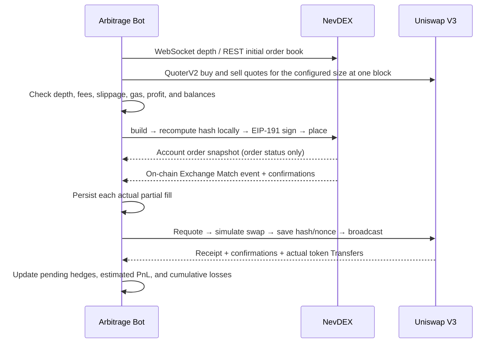

# NevDEX × Uniswap V3 Arbitrage Bot

Other standalone implementations: [Node.js](../node-arbitrage/README.md) · [Rust](../rust-arbitrage/README.md).

A standalone Go project based on the actual APIs, order signatures, Exchange events. The default pair is CASHCAT/USDG on Robinhood Chain (4663). When changing markets, also update both token addresses and the corresponding direct V3 pool.

## Quick Start

Requires Go 1.23 or later.

```bash
cd ./go-arbitrage
cp arbitrage.example.json arbitrage.json
go build -trimpath -o bin/arbitrage ./cmd/arbitrage

# Check the market, chain ID, token decimals, and official Factory / Pool / Router / Quoter
./bin/arbitrage --config arbitrage.json --check

# Read one order book and executable quotes for the configured size, then exit
./bin/arbitrage --config arbitrage.json --once

# Monitor continuously in read-only mode; press Ctrl+C to exit
./bin/arbitrage --config arbitrage.json
```

These modes do not read private keys, create recovery directories, sign messages, place or cancel orders, or broadcast transactions. `--once` and `--check` have a 30-second timeout and exit with a nonzero status on read failures. The default configuration is an example; it does not guarantee current pool liquidity or an arbitrage opportunity.

## Execution Model

A successful NevDEX HTTP response only acknowledges queue submission; matching and on-chain settlement follow separately. This bot manages one arbitrage cycle at a time for each wallet:



| Arbitrage route | NevDEX first leg | Uniswap hedge after the actual fill is confirmed |
| --- | --- | --- |
| `BUY_UNI_SELL_MYOB` | Crossing sell limit order, `postOnly:false` | Buy back the same base amount with `exactOutputSingle` |
| `BUY_MYOB_SELL_UNI` | Crossing buy limit order, `postOnly:false` | Sell the same base amount with `exactInputSingle` |

Route names describe the combined trade direction. Actual execution always starts with a NevDEX fill. Both venues require prefunded inventory; settlement proceeds do not automatically move from the Vault to the wallet.

- Calculations use `decimal.Decimal` and `big.Int`, without `float64`. Order quantities are base-token amounts, and all monetary configuration values are JSON strings.
- The planner walks the visible order book and requires sufficient quantity. Profit is calculated assuming **the entire order fills at its worst permitted limit price**, rather than treating the visible average price as guaranteed execution.
- QuoterV2 simulates the actual size, including pool fees and price impact. The planner additionally deducts the higher NevDEX maker/taker fee, slippage and gas budgets, and an integer-rounding buffer. Net profit must meet both the absolute and percentage thresholds.
- A wallet has at most one unfinished cycle. Each `Match` is deduplicated by `transactionHash:logIndex`. Account snapshots, matching notifications, and disappearing orders do not directly trigger a hedge.
- Remaining orders are submitted for cancellation after the configured delay. Cancellation only acknowledges queue submission. Recovery records remain until the signed order expires, no open account orders remain, confirmed event scanning catches up, and hedging finishes. A cycle can therefore take more than a minute with the default settings.
- Disconnected or stale market data pauses new orders and triggers cancellation attempts. On-chain fill scanning and hedging continue independently of the market connection. RPC failures or insufficient hedge funds cause the bot to retain its records and exit.

Execution across the two venues is not atomic. Prices can move between a NevDEX fill and its Uniswap hedge. Partial fills are hedged separately and can incur multiple gas charges; small fills may earn less than the full-order estimate.

## Live Trading Setup

The Vault, Exchange, and private-key path are intentionally empty in `arbitrage.example.json`. Before live trading, configure these fields in `arbitrage.json`:

```json
{
  "vaultAddress": "REVIEWED_VAULT_ADDRESS",
  "exchangeAddress": "EXCHANGE_ADDRESS_BOUND_TO_THIS_VAULT",
  "account": "DEDICATED_EOA_ADDRESS",
  "privateKeyFile": "keys/arbitrage.key"
}
```

This is a field example to incorporate into the full configuration, not a set of usable deployment addresses. Relative paths are resolved from the configuration file's directory.

1. Use a dedicated EOA. Do not run another bot, trade manually, or send other transactions from the same wallet concurrently.
2. Prefund base and quote tokens in the reviewed NevDEX Vault for the first leg. The bot checks available balances after accounting for funds locked across the account.
3. Separately fund the wallet with base, quote, and native gas tokens for hedge swaps. Manually grant the official SwapRouter02 an appropriate bounded allowance. The bot does not automatically approve tokens, deposit, withdraw, or transfer funds between venues.
4. Store the private key in a private file owned by the current user: 64 hexadecimal characters, optionally prefixed with `0x`. Run `chmod 600 keys/arbitrage.key`. Do not put the key in JSON, command-line arguments, or Git.

```bash
./bin/arbitrage --config arbitrage.json --live
```

Only `--live` submits real orders, cancellations, and swaps. It cannot be combined with `--once` or `--check`. Startup checks that the Vault has deployed code and verifies both `Exchange.vault()` and `Vault.exchange()` bindings. Address binding checks do not replace a contract audit. If the deployment still requires the Vault fix and migration, complete that work first.

## Configuration

See [arbitrage.example.json](arbitrage.example.json) for the complete template. Monetary budgets use the market's quote token, USDG by default, rather than a hardcoded USDC denomination.

| Field | Default | Description |
| --- | --- | --- |
| `orderAmount` | `"0.1000"` | Maximum base-token amount per arbitrage cycle |
| `minProfitPct` | `"0.005"` | Net profit after costs divided by buy cost must be at least 0.5% |
| `minProfitQuote` | `"0.0001"` | Minimum absolute net profit |
| `gasCostQuote` | `"0.001"` | Gas budget per hedge in quote tokens; update manually for actual token prices |
| `slippageBPS` | `50` | A 0.5% price bound beyond the Quoter quote |
| `maxQuotePerTrade` | `"1"` | Quote amount cap for each first leg and hedge, including applicable reserves |
| `maxTotalQuote` | `"10"` | Persistent cumulative cycle budget, charged using each submission's conservative commitment; cancellations and unfilled orders do not refund it |
| `maxLossQuote` | `"0.1"` | Cumulative absolute estimated losses; profits do not offset losses, and reaching the cap stops new cycles |
| `maxFeeRate` | `"0.01"` | Maximum permitted market fee rate |
| `maxGasPriceGwei` | `"100"` | Hedge gas-price cap |
| `maxHedgeGasNative` | `"0.001"` | Native-token cap for each hedge's `gasLimit × gasPrice` |
| `confirmations` | `3` | Subsequent blocks required for settlement and hedge confirmations |
| `pollMilliseconds` | `1000` | Minimum processing interval after market events, also used for chain scanning and recovery |
| `cancelAfterMilliseconds` | `1500` | Delay before requesting cancellation of the remaining first-leg limit order |
| `orderTTLSeconds` | `60` | Signed order lifetime, from 60 to 120 seconds |
| `timeoutSeconds` | `10` | Timeout for each HTTP / RPC request |
| `maxDataAgeSeconds` | `30` | Freshness limit for market data, account connections, and RPC blocks; allow headroom for the server's usual 20-second ping interval |
| `stateDir` | `.arbitrage-state` | Recovery directory, with mode 700 for directories and 600 for files |

`estimatedPnLRaw` and `cumulativeLossRaw` use quote-token integer units. Gas deductions use the configured budget, not the actual native-token exchange rate, so these values are not precise accounting reports. Loss and budget limits stop new cycles; existing fills still require hedging.

## Restart and Shutdown

State is stored at `stateDir/<wallet>/state.json`, using a temporary file, `fsync`, atomic rename, and directory synchronization. A process lock prevents concurrent use of the same state directory. Always reuse the same directory; do not switch directories to bypass recovery.

- First startup requires no existing orders or pending settlements in the market. The bot saves the current block as its scan starting point and does not hedge historical trades from before startup.
- The original NevDEX order ID and intent are saved before submitting the signature. If the submission response is lost, do not blindly create a new order.
- Before broadcasting a swap, the bot saves its hash, nonce, fill ID, and deadline. State contains no private keys, signatures, or raw transactions. A lost broadcast response causes an exit; after restart, the bot checks only the original hash to avoid duplicate hedges.
- Unconfirmed receipts remain pending. Failed receipts, mismatched actual Transfer amounts, a reorganization affecting the scan cursor, or a prolonged lack of a receipt stop execution while preserving exposure records. Reconcile the original transaction and nonce before proceeding. The bot does not automatically replace transactions or compensate for reorganizations.
- Ctrl+C / SIGTERM attempts to cancel the recorded first leg, waits up to 10 seconds, then exits while preserving state. Cancellation is asynchronous, and settlement can occur while the bot is stopped. Restart resumes scanning from the saved cursor.
- Do not delete `state.json` to clear an error or reset budgets. Reconcile chain and order state first if there are unfinished orders, pending hedges, or uncertain broadcasts. The process lock uses the system's `flock` and is released automatically on exit; the lock file does not need to be deleted.

## Verification

```bash
go vet ./...
make build
```

## Code and Interface References

| File | Responsibility |
| --- | --- |
| `cmd/arbitrage/main.go` | CLI, read-only / live modes, and signal handling |
| `internal/arbitrage/arbitrage.go` | Event loop, opportunity evaluation, and first-leg submission |
| `internal/arbitrage/engine_setup.go` | Deployment validation and live-wallet initialization |
| `internal/arbitrage/cycle.go` | Order reconciliation and pending hedge recovery |
| `internal/arbitrage/arbitrage_plan.go` | Depth, worst-case limit prices, net profit, and risk budgets |
| `internal/arbitrage/arbitrage_chain.go` | Quoter calls, Match scanning, swaps, receipts, and actual net token transfers |
| `internal/arbitrage/arbitrage_state.go` | Process locking, persistence, and recovery identity validation |
| `internal/arbitrage/order.go` / `signature.go` | Build validation, local order hashes, and 96-byte EIP-191 signatures |
| `internal/arbitrage/client.go` / `rpc.go` | REST, JSON-RPC, and available Vault balances |
| `internal/arbitrage/price.go` / `order_feed.go` | Market and account WebSockets, reconnection, and freshness |

To follow the execution flow, start with `RunArbitrage`, then read `run` and `step`. Each live step calls `reconcileCycle` before evaluating a new opportunity with `arbPlan` and submitting it with `place`. All components use one `ArbitrageConfig`. Existing recovery files remain readable.

The bot uses the actual POST routes `/api/getMarket`, `/api/order/orderbook`, `/api/lockedBalance`, `/api/order/build`, `/api/order/place`, and `/api/order/cancel`, plus `/api/v1/ws` and `/api/v1/orders/ws?openOnly=1`.

- NevDEX references: [DEVELOPER_HUB.md](https://github.com/NevDEX/docs/blob/main/DEVELOPER_HUB.md).
- [Official Uniswap deployment addresses for chain 4663](https://github.com/Uniswap/contracts/blob/main/deployments/4663.md).
- [QuoterV2 ABI](https://github.com/Uniswap/v3-periphery/blob/main/contracts/interfaces/IQuoterV2.sol).
- [SwapRouter02 V3 ABI](https://github.com/Uniswap/swap-router-contracts/blob/main/contracts/interfaces/IV3SwapRouter.sol): swap tuples have no deadline field; the outer `multicall(uint256,bytes[])` supplies the deadline.

Currently supports standard ERC-20 tokens, one wallet, one market, and a direct V3 pool.